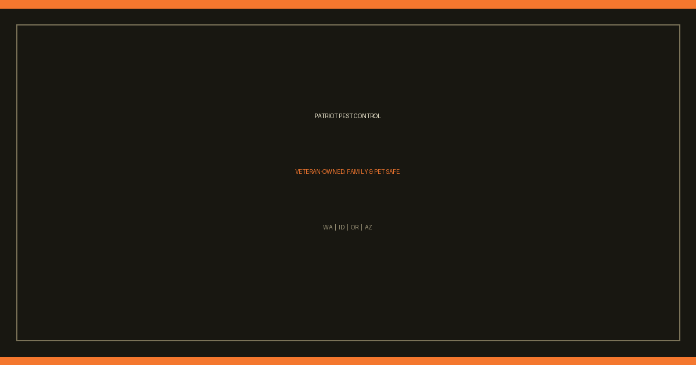

<!--
INSTRUCTIONS FOR THIS FILE (user and AI: read before editing. Keep this header.)

WHAT THIS FILE IS: the project's front door on GitHub. A stranger decides
in ten seconds whether this project is real. Everything here must be true
today: badges only when true, status only with proof, quickstart commands
copied from the working build.

EXACT STRUCTURE: centered title in exact brand casing, one-line promise,
true badges, the standard-files link row, What it is, Quickstart, the
module map (the grid), Status, License. Full art direction lives in the
github-repo-standard skill (README standard + README-PATTERNS.md).

RULES:
- Brand casing is exact: AlphaVision, AlphaFlux, iTaK, Mimir,
  Patriot Pest Control in full.
- David's taste: black background with a bright color on top so things
  pop is his preferred look; black and red are his favorite scheme, not
  a law. Each project picks its own palette.
- No secrets, passwords, or tokens in this file, ever.
-->
<div align="center">

# Patriot Pest Control

The public website for Patriot Pest Control: local service content, lead capture, and a fast front door into AlphaFlux.




</div>

**Plan:** [PLAN.md](PLAN.md) · **Tasks:** [TODO.md](TODO.md) · **Ideas:** [IDEA.md](IDEA.md) · **Build rules:** [docs/RULES.md](docs/RULES.md)

## What it is

This Go service serves patriotpest.pro for Patriot Pest Control in Eastern Washington and North Idaho. It owns the public pages, pest library, service areas, blog, FAQs, prices, search, contact and signup forms, sitemap, RSS, PWA shell, health endpoints, and first-party analytics intake.

The only public website number is **(509) 471-5767**.

## The AlphaFlux boundary

Customer, staff, and admin dashboards live in AlphaFlux, along with the CRM, FieldRoutes integrations, Twilio integrations, and private APIs. This site does not authenticate customers or staff.

- `/login`, `/logout`, `/account`, `/dashboard`, `/customer-dashboard`, `/customer-portal`, `/staff-dashboard`, `/staff`, and `/su` redirect to `ALPHAFLUX_LOGIN_URL`.
- `/admin` and `/admin/*` redirect to the same platform login.
- Legacy `/api/*` paths return `410 Gone` because AlphaFlux owns the API.

Website forms post valid leads to the AlphaFlux CRM capture endpoint with website form attribution. If capture is unavailable or no key is configured, the site falls back to its local store so a lead is not discarded.

## Quickstart

```bash
go build -o /tmp/patriot-landing ./cmd/server
DB_PATH=database/patriot.db ADDR=:3120 APP_ENV=local /tmp/patriot-landing
```

Run the package tests with:

```bash
go test ./...
```

## The grid: module map

| Module | What it owns |
| :--- | :--- |
| `cmd/server` | Entrypoint, route composition, platform redirects, API retirement, graceful shutdown |
| `internal/config` | Environment driven configuration and feature defaults |
| `internal/modules/marketing` | Public pages, search, sitemap, RSS, signup, contact, lead capture, beacon sink |
| `internal/modules/health` | `/health`, `/ready`, and `/metrics` |
| `internal/view` | Page modules, templates, embedded assets, PWA shell, SEO, pest and area copy |
| `internal/data` | SQLite content catalog, analytics, drafts, and local signup fallback |
| `internal/middleware` | Shared HTTP middleware |
| `pkg/crypto` | Cryptographic helpers |
| `tools/sitemap-lastmod` | Sitemap timestamp generation |

## Configuration

| Env | Default | Purpose |
| :--- | :--- | :--- |
| `ADDR` | `:3000` | Listen address |
| `DB_PATH` | `database/patriot.db` | SQLite content catalog |
| `APP_URL` | `https://patriotpest.pro` | Canonical origin |
| `ALPHAFLUX_LOGIN_URL` | `https://alphaflux.net/login` | Where sign-in links go |
| `MARKETING_ENABLED` | `true` | Gates the public pages module |
| `ALPHAFLUX_API_KEY` | none | Deployment secret for CRM lead capture; never commit it |

## Production

Dokploy deploys this repo from the root `Dockerfile`. **Push to `main` auto-deploys.**

Runtime mounts:

- `/home/server/go-patriot/data/patriot.db` to `/app/database/patriot.db`
- `/home/server/go-patriot/data/settings.json` to `/app/storage/settings.json`

Domains are `patriotpest.pro` and `www.patriotpest.pro`, with Let's Encrypt through Dokploy Traefik.

## Status

The public site and CRM lead leg are live and were verified on 2026-10-16. Two alert items stay open in TODO Phase 3: SMS delivery is blocked until Patriot A2P registration is approved, and the email alert leg waits for Skyler's confirmed alert address.

## License and credits

No LICENSE file is present in this repository, so public visibility is not a reuse license. Patriot Pest Control website content belongs to its owner. The connected business platform is AlphaFlux.
