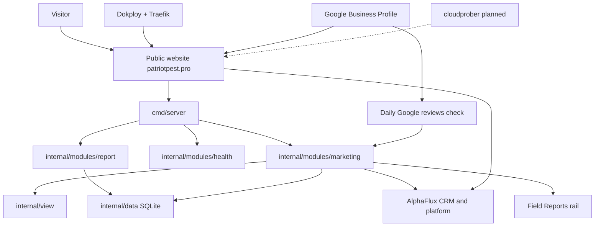

<!--
About this file (a description of what it holds and the conventions it follows).

This file is the whole project laid out, at docs/MAP.md: every
module, page, screen, engine, and service, and every link between them
traced both ways (what it points to, and what points back at it), so
the entire system can be seen at once and thought about whole. A
rendered visual version is generated from this file.

Structure:
- "## The grid": a table of every node: name, kind (page, screen,
  module, engine, service, external), what it owns.
- "## Links": a table of every connection: from, to, kind (navigates,
  calls, reads, writes, emits, hosts), and the backlink (the reverse
  relationship, named, or "none").
- "## Diagram": a Mermaid flowchart of the same nodes and links, kept
  in sync with the tables above it.
- "## Flows": the two or three main journeys through the system, in
  words, step by step.

Conventions:
- Every node in the tables appears in the diagram and vice versa.
- When a module or link is added or removed, this file changes in the
  same commit.
- Facts only: the map shows what exists, with planned nodes marked
  (planned) so vision and reality never blur.
- The file holds no secrets, passwords, or tokens.
-->
# MAP: Patriot Pest Control

## The grid
| Node | Kind | Owns |
| :--- | :--- | :--- |
| Visitor | external | Arrives from search, ads, and social; calls or submits a form |
| Public website (patriotpest.pro) | page | Marketing pages, pest library, areas, blog, FAQs, prices, referral, search, sitemap, RSS, PWA shell |
| cmd/server | module | Process start, route composition, legacy redirects, retired /api/* answers, shutdown |
| internal/modules/marketing | module | Public pages, search, sitemap, forms (contact, signup, free quote, SMS opt-in), lead capture, analytics beacon sink (consent-gated), visitor data erasure door (POST /api/track/forget), Google reviews sync door |
| internal/modules/health | module | /health, /ready, /metrics |
| internal/modules/report | module | Status dashboard, served only on the report.patriotpest.pro host |
| Field Reports rail (home page section) | page | Newest five-star Google customer reviews rendered from the stored snapshot; the owner's own reviews are stored but never render |
| internal/view | module | Templates, embedded assets, PWA files, SEO helpers, pest and area copy |
| internal/data | module | SQLite content catalog, analytics storage, drafts, local lead fallback store, Google reviews snapshot (newest 12 plus profile total and average), SMS consent records (structured opt-in proof: who, when, which form, exact wording) |
| internal/middleware | module | Shared request behavior |
| Dokploy + Traefik | external | Builds the root Dockerfile on push to main; TLS for patriotpest.pro |
| AlphaFlux | external | Accounts, dashboards, CRM records and attribution, alert delivery, FieldRoutes, Twilio |
| Google Business Profile | external | Local listing; source of the reviews snapshot; posting paused under appeal (DECISIONS 2026-10-15) |
| Daily Google reviews check | external | Each morning: reads the profile's newest reviews, posts owner replies (never to the owner's own reviews), and syncs the snapshot to the website |
| cloudprober uptime alerting | external (planned) | Probes the live site and alerts the operations channel (PLAN S4, TODO T-1.7) |

## Links
| From | To | Kind | Backlink |
| :--- | :--- | :--- | :--- |
| Visitor | Public website | navigates | Website renders pages and calls to action back |
| Public website | cmd/server | hosts | cmd/server composes the site's routes |
| cmd/server | internal/modules/marketing | calls | Marketing module registers its routes on the server |
| cmd/server | internal/modules/health | calls | Health module answers /health, /ready, /metrics for the server |
| cmd/server | internal/modules/report | calls | Report module registers its host-gated dashboard routes on the server |
| internal/modules/report | internal/data | reads | Data returns the analytics the dashboard renders |
| internal/modules/marketing | internal/view | reads | View supplies the templates and copy the module serves |
| internal/modules/marketing | internal/data | writes | Data returns catalog content, stores fallback leads, and holds the reviews snapshot for the module |
| internal/modules/marketing | internal/data | deletes | POST /api/track/forget removes one visitor's analytics rows when the privacy page's tracking-data control presents that visitor's id |
| Daily Google reviews check | Google Business Profile | reads | GBP shows the reviews, totals, and reply state the check works from |
| Daily Google reviews check | internal/modules/marketing | writes | Marketing verifies the sync token and stores the snapshot, answering ok/stored (POST /api/reviews/sync) |
| Field Reports rail (home page section) | internal/data | reads | Data serves the rail its snapshot through the marketing module's home handler |
| internal/modules/marketing | AlphaFlux | writes | AlphaFlux stores the CRM lead and returns capture confirmation |
| Public website | AlphaFlux | navigates | Sign-in and dashboard paths redirect the visitor to AlphaFlux login |
| Dokploy + Traefik | Public website | hosts | Website deploy status reports back to Dokploy |
| Google Business Profile | Public website | navigates | Website carries the listing's canonical name, market, and number |
| cloudprober uptime alerting (planned) | Public website | calls | Website answers probes; alerts flow to the operations channel |

## Diagram

## Flows
1. A customer finds a pest or area page, reads it, and either calls (509) 471-5767 or submits the contact form. The marketing module validates the form (phone required), writes the lead to the AlphaFlux CRM with website-form attribution, and falls back to the local store if capture fails, so a lead survives a CRM outage; if both stores fail, the visitor is told to call instead of being shown a success message.
2. A deploy flows from a push to main: Dokploy builds the root Dockerfile, Traefik serves the new container at patriotpest.pro, and the verify checks in docs/RUNBOOK.md confirm the pages, endpoints, name, and number.
3. A returning customer or staff member follows a sign-in link on the site and is redirected to AlphaFlux, where accounts and dashboards live; this repo never authenticates them.
4. Reviews: each morning the daily check reads the newest Google reviews, posts owner replies to customer reviews (never to the owner's own), and POSTs the newest 12 plus the profile total and average to /api/reviews/sync. The marketing module checks the sync token and stores the snapshot in SQLite; the home page's Field Reports rail renders the newest five-star customer reviews from that snapshot. The owner's own reviews are stored with the rest but filtered out of the rail (internal/modules/marketing/reviews.go).
