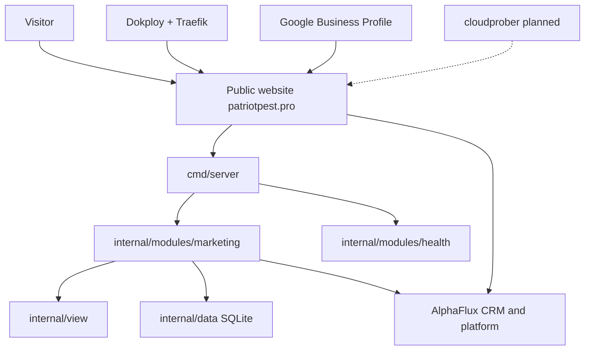

<!--
INSTRUCTIONS FOR THIS FILE (user and AI: read before editing. Keep this header.)

WHAT THIS FILE IS: the whole project laid out, at docs/MAP.md: every
module, page, screen, engine, and service, and every link between them
traced BOTH ways (what it points to, and what points back at it). It
exists so anyone can see the entire system at once and think about it
whole. A rendered visual version is generated from this file.

EXACT STRUCTURE:
- "## The grid": a table of every node: name, kind (page, screen,
  module, engine, service, external), what it owns.
- "## Links": a table of every connection: from, to, kind (navigates,
  calls, reads, writes, emits, hosts), and the backlink (the reverse
  relationship, named, or "none").
- "## Diagram": a Mermaid flowchart of the same nodes and links, kept
  in sync with the tables above it.
- "## Flows": the two or three main journeys through the system, in
  words, step by step.

RULES:
- Every node in the tables appears in the diagram and vice versa.
- When a module or link is added or removed, this file changes in the
  same commit.
- Facts only: the map shows what exists, with planned nodes marked
  (planned) so vision and reality never blur.
- No secrets, passwords, or tokens in this file, ever.
-->
# MAP: Patriot Pest Control

## The grid
| Node | Kind | Owns |
| :--- | :--- | :--- |
| Visitor | external | Arrives from search, ads, and social; calls or submits a form |
| Public website (patriotpest.pro) | page | Marketing pages, pest library, areas, blog, FAQs, prices, referral, search, sitemap, RSS, PWA shell |
| cmd/server | module | Process start, route composition, legacy redirects, retired /api/* answers, shutdown |
| internal/modules/marketing | module | Public pages, search, sitemap, forms, lead capture, analytics beacon sink |
| internal/modules/health | module | /health, /ready, /metrics |
| internal/view | module | Templates, embedded assets, PWA files, SEO helpers, pest and area copy |
| internal/data | module | SQLite content catalog, analytics storage, drafts, local lead fallback store |
| internal/middleware | module | Shared request behavior |
| Dokploy + Traefik | external | Builds the root Dockerfile on push to main; TLS for patriotpest.pro |
| AlphaFlux | external | Accounts, dashboards, CRM records and attribution, alert delivery, FieldRoutes, Twilio |
| Google Business Profile | external | Local listing; posting paused under appeal (DECISIONS 2026-10-15) |
| cloudprober uptime alerting | external (planned) | Probes the live site and alerts the operations channel (PLAN S4, TODO T-1.7) |

## Links
| From | To | Kind | Backlink |
| :--- | :--- | :--- | :--- |
| Visitor | Public website | navigates | Website renders pages and calls to action back |
| Public website | cmd/server | hosts | cmd/server composes the site's routes |
| cmd/server | internal/modules/marketing | calls | Marketing module registers its routes on the server |
| cmd/server | internal/modules/health | calls | Health module answers /health, /ready, /metrics for the server |
| internal/modules/marketing | internal/view | reads | View supplies the templates and copy the module serves |
| internal/modules/marketing | internal/data | writes | Data returns catalog content and stores fallback leads for the module |
| internal/modules/marketing | AlphaFlux | writes | AlphaFlux stores the CRM lead and returns capture confirmation |
| Public website | AlphaFlux | navigates | Sign-in and dashboard paths redirect the visitor to AlphaFlux login |
| Dokploy + Traefik | Public website | hosts | Website deploy status reports back to Dokploy |
| Google Business Profile | Public website | navigates | Website carries the listing's canonical name, market, and number |
| cloudprober uptime alerting (planned) | Public website | calls | Website answers probes; alerts flow to the operations channel |

## Diagram

## Flows
1. A customer finds a pest or area page, reads it, and either calls (509) 471-5767 or submits the contact form. The marketing module validates the form (phone required), writes the lead to the AlphaFlux CRM with website-form attribution, and falls back to the local store if capture fails, so no lead is discarded.
2. A deploy flows from a push to main: Dokploy builds the root Dockerfile, Traefik serves the new container at patriotpest.pro, and the verify checks in docs/RUNBOOK.md confirm the pages, endpoints, name, and number.
3. A returning customer or staff member follows a sign-in link on the site and is redirected to AlphaFlux, where accounts and dashboards live; this repo never authenticates them.
